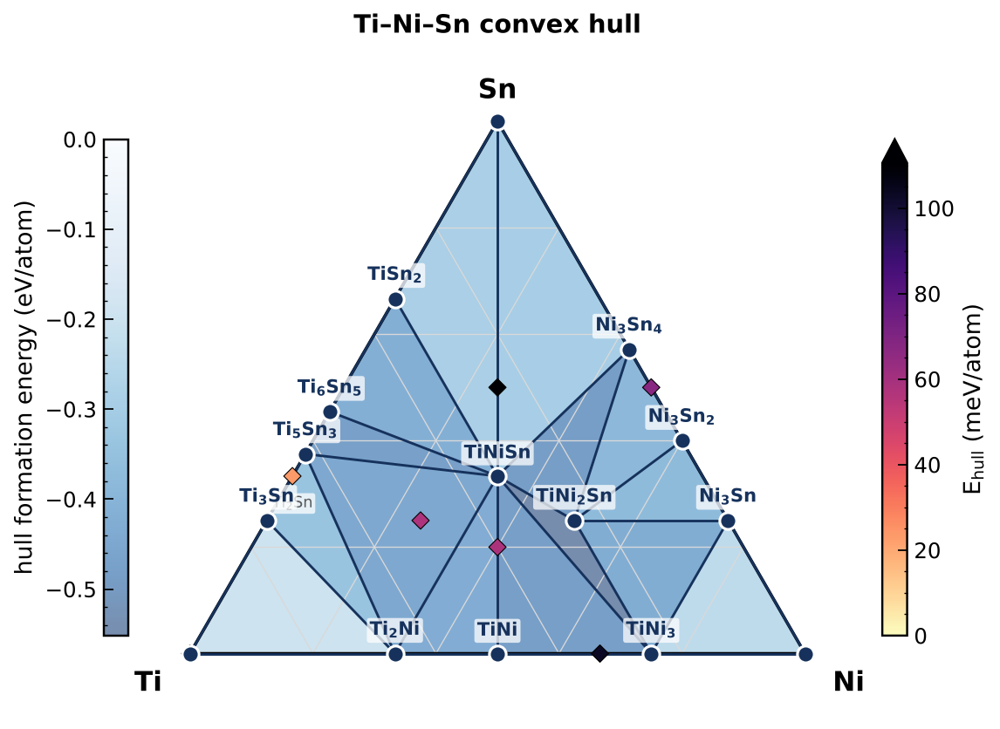

<p align="center">
  
  
</p>

# SymPhase

**Magnetic symmetry, symmetry-allowed charge / spin / orbital conductivity tensors and convex-hull
phase stability for VASP calculations — elements in, everything out, on all your cores.**

| command | input | output |
|---|---|---|
| `symphase tensors` | `POSCAR`, `INCAR`, `OUTCAR`, `OSZICAR` of a VASP run (POSCAR + INCAR is enough) | space group, **magnetic space group** (BNS/OG, type I–IV), magnetic point group, presence of **P, T, PT, T·τ**, mirrors, M·T, C<sub>n</sub>·T, all operations; allowed **σ<sub>ij</sub>**, **σ<sup>k</sup><sub>ij</sub>(spin)**, **σ<sup>k</sup><sub>ij</sub>(orbital)**, T-even / T-odd, anomalous Hall vector, unconventional spin polarisations; **spin group** (no SOC): altermagnet / AFM / FM class, spin Laue group, d/g/i-wave spin splitting, NR tensors, SOC-only components |
| `symphase hull` | VASP runs, CSV, Materials Project | formation energy, **E<sub>hull</sub>**, decomposition, stability margin, figures for **any number of elements**, high-throughput screening, **finite-T hulls** (mixing entropy, phonons); parallel (all cores or MPI) |
| `symphase magnons` | POSCAR + INCAR/OUTCAR moments (collinear or non-collinear), exchange J per symmetry class or bond file (J, DMI, tensors) | magnons of **collinear and non-collinear FM/AFM** (LSWT in local frames) **incommensurate single-Q spirals without supercells** (rotating frame, optimal q) and a **supercell workflow** for multi-Q (skyrmion crystals), conical and anisotropy-distorted states (Luttinger–Tisza, auto size, multi-seed relaxation, topological charge, magnetic field): chirality / magnon-spin vectors, Δω(q) maps, d/g/i-wave check, classical relaxation, non-reciprocity |
| `symphase run` | **just the elements**, e.g. `Ti Ni Sn` | all phases from OQMD (no key) or Materials Project, hull, figures, POSCARs, VASP inputs + **Ibex job array**, HTML report |

📊 **Presentation:** [`docs/SymPhase_presentation.pdf`](docs/SymPhase_presentation.pdf) (42 slides, Beamer source included)
📓 **Tutorials & quizzes:** [`notebooks/`](notebooks) — 8 tutorials, 5 quizzes × 20 self-checking questions
🧭 **Supercell guide:** [`docs/SUPERCELL_WORKFLOW.md`](docs/SUPERCELL_WORKFLOW.md) — every step from exchange constants to DFT checks for multi-Q / conical / distorted states

---

## Installation

```bash
git clone https://github.com/Gokaran-Shukla/symphase
cd symphase
pip install -e .                 # numpy, spglib>=2, pymatgen, matplotlib
pip install -e ".[mp,mpi,notebooks]"   # optional: Materials Project, MPI, Jupyter
```

On Ibex (conda):
```bash
source /home/shuklagn/anaconda3/etc/profile.d/conda.sh
conda create -n symphase python=3.11 -y && conda activate symphase
pip install -e .
```

## 1 · Elements in, everything out

```bash
symphase run Ti Ni Sn                 # or:  symphase run Ti-Ni-Sn
symphase run symphase.in              # file with one line:  elements = Ti Ni Sn
symphase run Ti Ni Sn write_vasp=yes ehull_window=0.05
```
Creates `symphase_Ni-Sn-Ti/` with `SUMMARY.html`, `hull_table.csv`, `figures/`, `structures/`, `vasp/`
(INCAR, KPOINTS, POSCAR, POTCAR.spec per phase + `submit_ibex.sh`) and a cache of the database entries.
Data source: Materials Project if `MP_API_KEY` is set, otherwise **OQMD** (no key needed).

After the Ibex jobs have finished, rebuild the hull purely from your own DFT energies:
```bash
symphase run Ti Ni Sn source=vasp vasp_dir=symphase_Ni-Sn-Ti/vasp outdir=TiNiSn_myDFT
```
All options: `symphase run -h` · example input: [`jobs/symphase.in`](jobs/symphase.in).

## 2 · Magnetic symmetry and response tensors from a VASP run

```bash
cd my_vasp_run/
symphase tensors                              # POSCAR + OUTCAR + OSZICAR
symphase tensors -p CONTCAR --mmin 0.1        # final structure, ignore |m| < 0.1 μB
symphase tensors --mdir 1 1 0                 # collinear moments along [110]
symphase tensors --magmom "0 0 3  0 0 -3  4*0"  # override moments (3N Cartesian)
symphase tensors --frame std --json res.json --out report.txt
```
```python
from symphase import analyze_tensors
r = analyze_tensors("examples/vasp/RuO2_Neel100_SOC")
r["magnetic"]["bns_symbol"], r["tensors"]["charge"]["hall_vector"]   # ("Pnn'm'", ['0', '-σ_xz', '0'])
```

Moments: `--magmom` > OUTCAR site moments > **INCAR `MAGMOM`** > OUTCAR echo; ISPIN / LSORBIT / LNONCOLLINEAR / SAXIS
from OUTCAR, else INCAR (non-collinear MAGMOM is rotated from the SAXIS frame). A POSCAR + INCAR pair is enough to
analyse a magnetic configuration *before* running VASP.

### Spin groups — non-relativistic altermagnetism (`--analysis spin`, default `both`)
Without SOC spin and lattice rotate independently: elements [U‖g]. SymPhase finds U for every crystal operation
(m<sub>g(i)</sub> = U m<sub>i</sub>, Procrustes/SVD), adds the spin-only group (O(3), <sup>∞</sup>m1, <sup>m</sup>1) and reports

* magnet class — ferromagnet, conventional AFM ([C₂‖τ]), PT-AFM ([C₂‖P]), **altermagnet**
* spin Laue group (e.g. ²4/¹m²m¹m), spin-splitting form **s(k)** (s-, p-, d-, g-, i-wave) and nodal planes
* non-relativistic charge / spin / orbital tensors and the components that exist **only with SOC**

| example | class | spin Laue group | NR splitting |
|---|---|---|---|
| RuO₂, Néel ∥ z | altermagnet | ²4/¹m²m¹m | d-wave, s<sub>z</sub> ∝ k<sub>x</sub>k<sub>y</sub> |
| MnTe (INCAR only) | altermagnet | ²6/²m¹m²m | g-wave, s<sub>z</sub> ∝ k<sub>z</sub>k<sub>y</sub>(k<sub>y</sub>²−3k<sub>x</sub>²) |
| bcc Cr (INCAR only) | AFM [C₂‖τ] | — | none |
| Mn₂Au (INCAR only) | PT-AFM | — | none |
| bcc Fe | ferromagnet | ¹4/¹m¹-3¹m | s-wave |

```bash
symphase tensors --analysis spin              # spin group only
python -c "from symphase import analyze_tensors as a; print(a('.')['spin_group']['spin_splitting'])"
```

### Spin-space-group numbers
Collinear spin space groups ([E‖h] ∪ [C₂⊥‖a]) ⊗ <sup>∞</sup>m1 correspond one-to-one to the black-and-white magnetic
groups of type I, III and IV (C₂⊥ → T): 230 + 674 + 517 = **1421** groups. SymPhase labels them by the BNS number of
that group (spglib on the scalar moments m·n; cross-checked with `spinspg`): RuO₂ → P4₂′/mn′m (136.498),
MnTe → P6₃′/m′mc′ (194.269), bcc Cr → P<sub>I</sub>m-3m (221.97), Mn₂Au → I4/m′mm (139.533), Fe → Im-3m (229.140).
Non-collinear orders get a structured description (lattice group, spin-preserving subgroup, spin point group).

### Magnon chirality splitting
```bash
symphase magnons --list-bonds --rmax 6.5                         # exchange bonds grouped by crystal symmetry
symphase magnons --J -0.5 3.0 -0.2 0 0.2 0 -0.6 -0.2 --K 0.05     # one J (meV, J>0 AFM) per class
symphase magnons --exchange J.dat                                # i j n1 n2 n3 J  (e.g. from magex / TB2J)
```
Linear spin-wave theory with Colpa diagonalisation; every mode carries ΔS<sub>z</sub> = ±1 (α/β) and the splitting
Δω(q) = ω<sub>β</sub> − ω<sub>α</sub> is checked against the spin-group form (RuO₂: d-wave, Δω ∝ q<sub>x</sub>q<sub>y</sub>, from the
inequivalent [110] / [1-10] bonds). Validated against the analytic ferromagnet and antiferromagnetic-chain dispersions.

### Non-collinear ferro- and antiferromagnets
Spin groups of coplanar / non-coplanar orders (Procrustes fit of the spin parts; spin-only group {E, C₂(n)T} or trivial),
classified as non-collinear antiferromagnets (compensated) or ferro/ferrimagnets (canted, weak FM), with the
spin-splitting form s(k) (odd p-/f-wave forms possible). Magnons by linear spin-wave theory in local frames
(Toth & Lake, J. Phys.: Condens. Matter 27, 166002 (2015)) for H = Σ S<sub>i</sub>·J<sub>ij</sub>·S<sub>j</sub> + Σ S<sub>i</sub>·A<sub>i</sub>·S<sub>i</sub>
with Heisenberg, Dzyaloshinskii–Moriya or full tensor exchange:
```bash
cd examples/vasp/Triangular_120AFM_INCAR && symphase magnons --J 1.0 --rmax 3.1
cd examples/vasp/CantedChain_DMI_INCAR   && symphase magnons --exchange J_DM.dat --relax --rmax 3.1
```
Exchange file lines: `i j n1 n2 n3 J` · `i j n1 n2 n3 J Dx Dy Dz` · `i j n1 n2 n3 Jxx … Jzz`.
Checks: ferromagnet along [111] ≡ along z; 120° triangular AFM = analytic 3JS√((1−γ)(1+2γ)) with 3 Goldstone modes;
DMI chain relaxes to the canting angle arctan(D/J) (weak ferromagnet).

### Incommensurate spirals — no supercell needed
A single-Q planar spiral S<sub>j</sub>(R) = R<sub>n</sub>(q·R) S<sub>j</sub>(0) is treated in the rotating frame: if the Hamiltonian is
invariant under rotations about n (Heisenberg, D ∥ n, anisotropy along n) every bond matrix becomes
J(R) → J(R) R<sub>n</sub>(2π q·R) and LSWT runs on the original cell. The optimal q is found by minimising the classical
energy (grid + Nelder–Mead over q, BFGS over sublattice phases); `--relax` in a fixed cell now warns when an
incommensurate spiral is lower in energy.
```bash
cd examples/vasp/Spiral_J1J2_chain && symphase magnons --J -1.0 0.5 --rmax 6.1 --spin 1 --spiral auto
cd examples/vasp/Helix_DMI_chain   && symphase magnons --exchange J_DMI.dat --rmax 3.1 --spin 1 --spiral auto
symphase magnons ... --spiral 0.25 0 0 --spiral-axis 0 0 1      # fixed q (r.l.u.) and rotation axis
```
Checks: J₁–J₂ chain q = arccos(|J₁|/4J₂)/2π with the analytic rotating-frame dispersion; DMI helix
q = arctan(D/|J|)/2π (period 95.5 Å = 31.8 a from a 1-atom cell); identical to an explicit 6-site supercell for q = 1/6.
Multi-Q, conical or anisotropy-distorted states: `--spiral` refuses them and points to the supercell workflow below.

### Multi-Q, conical and distorted states — magnetic supercells
```bash
cd examples/vasp/Skyrmion_triangular && symphase magnons --exchange J_DMI.dat --rmax 3.1 --spin 1 --field 0 0 14 --supercell auto
cd examples/vasp/Conical_J1J2_field  && symphase magnons --J -1.0 0.5 --rmax 6.1 --spin 1 --field 0 0 2 --supercell auto
cd examples/vasp/Distorted_spiral_K  && symphase magnons --J -1.0 0.5 --rmax 6.1 --spin 1 --K 0.4 --K-axis 1 0 0 --scan 4 13 --supercell auto
symphase tensors -p supercell/POSCAR -i supercell/INCAR        # symmetry + allowed tensors of the new state
```
1. Luttinger–Tisza scan → ordering vector q_LT and its star; 2. smallest supercell fitting every star member
(n × n for hexagonal stars; or `--supercell n1 n2 n3` / a 3×3 matrix); 3. exact mapping of exchange, anisotropy and
field (`--field Bx By Bz`, Tesla); 4. L-BFGS relaxation from many seeds (input, FM, LT single-Q, conical, multi-Q,
random; `--restarts`); 5. identification from the structure factor (single-Q / conical / fan / distorted with
harmonics / multi-Q / skyrmion crystal with lattice topological charge); 6. LSWT in the supercell; 7. `supercell/`
with POSCAR, non-collinear INCAR, `J_super.dat`, `spins.dat`, `seeds.dat` for VASP checks. `--scan NMIN NMAX` converges
the size for incommensurate states. Checks: cone angle = analytic (0.46307 at 2 T), skyrmion crystal N_sk = −3 per
10×10 cell for 8–20 T (MSG P6m'm', σ_xy allowed), J₂ = 0.4 chain: 7-cell approximant within 2×10⁻⁶ meV of the exact spiral.
Full step-by-step guide: [`docs/SUPERCELL_WORKFLOW.md`](docs/SUPERCELL_WORKFLOW.md).

### Finite-temperature hulls
G<sub>i</sub>(T) = E<sub>i</sub> + F<sup>vib</sup><sub>i</sub>(T) − T S<sup>conf</sup><sub>i</sub>
```bash
symphase hull --csv data.csv --temperatures 300 600 900 1200 --vib debye
symphase run Ti Zr Ni Sn temperatures="300 600 900 1200" vib=bartel
```
CSV columns: `mixing` (sublattices, e.g. `Ti0.5Zr0.5|Ni|Sn` → S = k<sub>B</sub> ln2/3 per atom) or `s_config`;
vibrations `debye` (`debye_T`), `phonopy` (`phonons` → `total_dos.dat` / `thermal_properties.yaml`) or `bartel`
(SISSO model via pymatgen). Reports E<sub>hull</sub>(T) and the temperature at which each phase reaches (or leaves) the hull;
(Ti₀.₅Zr₀.₅)NiSn with E<sub>hull</sub> = 5 meV/atom → T* = 251 K (analytic 251.1 K).

### Low-symmetry example: monoclinic MoO₂
`examples/vasp/MoO2_monoclinic` (P2₁/c, POSCAR + INCAR, unique axis b ∥ y): grey group P2₁/c1′, MPG 2/m1′;
σ<sub>ij</sub> has 4 independent components (incl. σ<sub>xz</sub>); spin and orbital Hall tensors have **13**
independent components each — exactly those with an odd number of y indices — including unconventional channels
(flow x, E ∥ y → S<sub>z</sub> and S<sub>x</sub>). Without SOC all spin components vanish, the orbital ones survive.

Conventions: J<sub>i</sub> = σ<sub>ij</sub>E<sub>j</sub>, J<sup>S<sub>k</sub></sup><sub>i</sub> = σ<sup>k</sup><sub>ij</sub>E<sub>j</sub> (i flow, j field, k polarisation).
For g′ = gT the T-odd part picks a factor −1 (Seemann *et al.*, PRB 92, 155138 (2015)); Onsager is imposed on σ<sub>ij</sub>.
Moments are treated as axial vectors coupled to the lattice (relativistic analysis; without SOC the true symmetry is a larger spin group).

## 3 · Convex hull for any number of elements

```bash
symphase hull --scan calcs/ -n 40 --plot hull.png        # every VASP run below calcs/
symphase hull --csv energies.csv --bar --surface
symphase hull --csv refs.csv --screen candidates.csv     # E_hull of new candidates
symphase hull --csv data.csv --slice TiNiSn HfNiSn --subsystems 3
srun -n 160 python -m symphase hull --csv refs.csv --screen big.csv   # MPI
```
CSV format: `formula,energy[,energy_type,name,structure]` — energy of the formula as written, or `energy_type=per_atom`.

```python
from symphase.hull import HullAnalysis, load_csv
h = HullAnalysis(load_csv("examples/hull/TiNiSn_ternary.csv"), nproc=-1)
h.print_table(); h.plot(save="hull.pdf")
h.decomposition("Ti2NiSn"); h.hull_formation_energy("TiNi2Sn2")
```

| elements | figure |
|---|---|
| 2 | formation-energy hull curve |
| 3 | Gibbs triangle with shaded facets + 3D hull surface |
| 4 | tetrahedron with tie-lines |
| any | grid of all binary/ternary sub-hulls, E<sub>hull</sub> bar chart, pseudo-binary slices |

### Parallelism
Per-entry E<sub>hull</sub>/decompositions/stability margins, candidate screening, VASP-folder parsing, pseudo-binary hull
points and per-phase symmetry analyses run in parallel: **process** backend on one node (fork, copy-on-write,
`-n`/`SYMPHASE_NPROC`/`SLURM_CPUS_PER_TASK`), **MPI** backend across nodes (`mpi4py`, launched with `srun`/`mpirun`).
Results are identical to serial (tested). Job scripts: [`jobs/ibex_symphase.slurm`](jobs/ibex_symphase.slurm),
[`jobs/ibex_symphase_mpi.slurm`](jobs/ibex_symphase_mpi.slurm).

## Tutorials and quizzes

| notebook | content |
|---|---|
| `01_tutorial_symmetry_tensors.ipynb` | Pt, Fe, altermagnetic RuO₂, **monoclinic MoO₂**, Néel-vector rotation, operations, **spin groups** (RuO₂, MnTe, Cr, Mn₂Au) |
| `02_tutorial_convex_hull.ipynb` | 2-, 3-, 4-, 5-element hulls, slices, screening, parallel benchmark |
| `03_tutorial_automatic_workflow.ipynb` | `symphase run`, OQMD/MP, VASP + Ibex round trip |
| `06_tutorial_spin_space_groups_magnons.ipynb` | SSG numbers, exchange-bond classes, LSWT magnon chirality splitting (RuO₂) |
| `07_tutorial_finite_temperature_hull.ipynb` | mixing entropy, Debye phonons, E<sub>hull</sub>(T), stabilisation temperatures |
| `08_tutorial_noncollinear_magnets.ipynb` | non-collinear spin groups, LSWT in local frames: [111] FM, 120° triangular AFM, canted DMI chain |
| `09_quiz_spin_groups_magnons_finiteT.ipynb` | **20 questions**: SSGs, magnons (collinear & non-collinear), finite-T hulls |
| `10_tutorial_incommensurate_spirals.ipynb` | rotating-frame LSWT, J₁–J₂ phase diagram, DMI helix, fixed-cell trap |
| `11_quiz_noncollinear_spirals.ipynb` | **20 questions**: non-collinear magnets and incommensurate spirals |
| `12_tutorial_magnetic_supercells.ipynb` | supercell workflow: size convergence, cone in a field, distorted spiral, skyrmion crystal field scan, DFT files, symmetry |
| `13_quiz_magnetic_supercells.ipynb` | **20 questions**: multi-Q, conical and distorted states in supercells |
| `04_quiz_symmetry_tensors.ipynb` | **20 questions** (conceptual + hands-on, incl. MoO₂) |
| `05_quiz_convex_hull.ipynb` | **20 questions** (conceptual + hands-on) |

```python
from symphase.quiz import Quiz
q = Quiz("hull"); q.answer(10, 42.5); q.hint(11); q.score(); q.widget(3)
```

## Repository layout
```
symphase/        package: tensors.py, spingroup.py, magnons.py, thermo.py, hull.py, hull_plots.py, auto.py, parallel.py, quiz.py, cli.py, data/
examples/vasp/   VASP test cases (Pt, Fe, RuO2 ×2, Mn3Sn)      examples/hull/  TOY energy data sets
notebooks/       tutorials + quizzes (+ build_notebooks.py)    docs/           presentation (PDF + .tex)
jobs/            Ibex SLURM scripts, example input              tests/          pytest suite (+ OQMD mock)
```

> ⚠️ `examples/hull/*` contain **toy energies** for teaching (see `make_toy_data.py`), not DFT results.

## Testing
```bash
pytest tests/
```

## How to cite / acknowledge
If you use SymPhase, please cite it (GitHub: **"Cite this repository"**, metadata in [`CITATION.cff`](CITATION.cff)):

> G. Shukla, *SymPhase: magnetic and spin-group symmetry, symmetry-allowed conductivity tensors and convex-hull
> phase stability for VASP*, version 1.0.0 (2026), https://github.com/Gokaran-Shukla/symphase.
> ORCID [0000-0001-9332-3332](https://orcid.org/0000-0001-9332-3332)

A Zenodo DOI is minted for every GitHub release (archive metadata in [`.zenodo.json`](.zenodo.json)).

Please cite the underlying tools: spglib (Togo *et al.*, Sci. Technol. Adv. Mater. Meth. 4, 2384822 (2024)),
pymatgen (Ong *et al.*, Comput. Mater. Sci. 68, 314 (2013)), and the data source you use — OQMD
(Saal *et al.*, JOM 65, 1501 (2013); Kirklin *et al.*, npj Comput. Mater. 1, 15010 (2015)) or the Materials Project
(Jain *et al.*, APL Mater. 1, 011002 (2013)). Magnetic space-group labels: Stokes & Campbell (ISO-MAG) tables.

## License
MIT — © 2026 Gokaran Shukla
