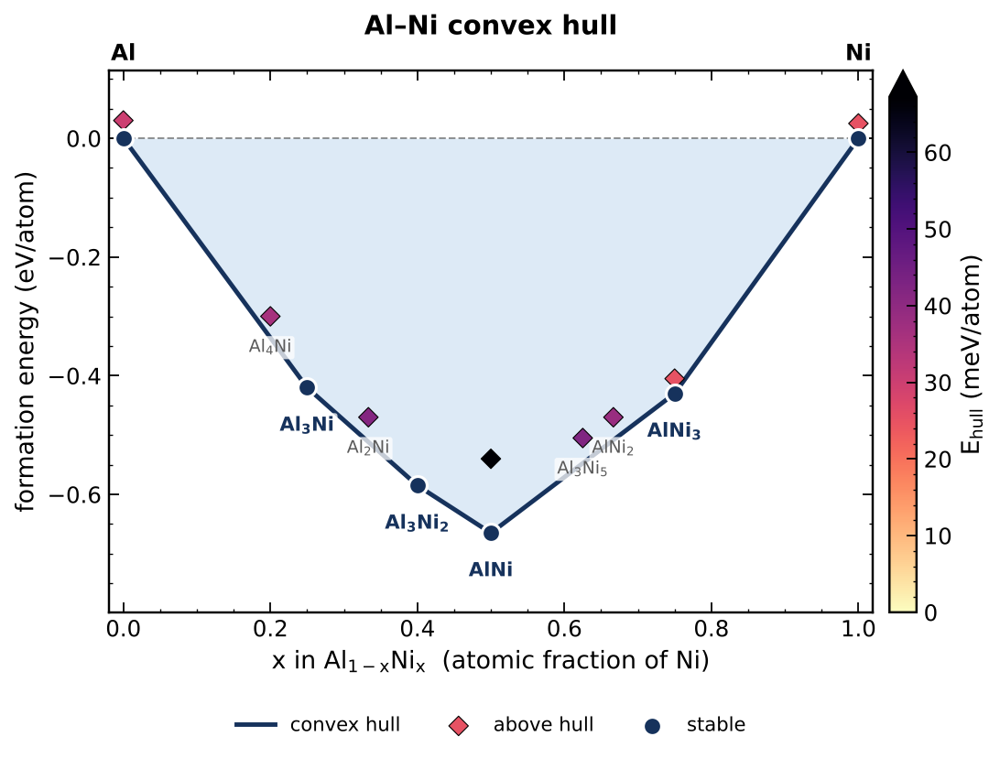

<p align="center">
  
  
</p>

# SymPhase

[](https://doi.org/10.5281/zenodo.24220936)

**Magnetic symmetry, symmetry-allowed charge / spin / orbital conductivity tensors and convex-hull
phase stability for VASP calculations — elements in, everything out, on all your cores.**

| command | input | output |
|---|---|---|
| `symphase tensors` | `POSCAR`, `INCAR`, `OUTCAR`, `OSZICAR` of a VASP run (POSCAR + INCAR is enough) | space group, **magnetic space group** (BNS/OG, type I–IV), magnetic point group, presence of **P, T, PT, T·τ**, mirrors, M·T, C<sub>n</sub>·T, all operations; allowed **σ<sub>ij</sub>**, **σ<sup>k</sup><sub>ij</sub>(spin)**, **σ<sup>k</sup><sub>ij</sub>(orbital)**, T-even / T-odd, anomalous Hall vector, unconventional spin polarisations; **spin group** (no SOC): **oriented spin-space-group number for any order** (collinear, coplanar, non-coplanar; Chen et al. 2024 via FindSpinGroup), altermagnet / AFM / FM class, spin Laue group, d/g/i-wave spin splitting, NR tensors, SOC-only components |
| `symphase hull` | VASP runs, CSV, Materials Project | formation energy, **E<sub>hull</sub>**, decomposition, stability margin, figures for **any number of elements**, high-throughput screening, **finite-T hulls** (mixing entropy, harmonic, **quasi-harmonic** and **anharmonic** free energies); parallel (all cores or MPI) |
| `symphase kubo` | POSCAR + INCAR/OUTCAR; postw90 `*-ahc/shc-fermiscan.dat`, any component table, or Wannier90 `seedname_hr.dat` | **magnitudes** of charge / spin / orbital conductivities constrained by symmetry: minimal component set + postw90 input, import and symmetry fit (full tensor, violation check), built-in Kubo solver (AHC, SHC) |
| `symphase magnons` | POSCAR + INCAR/OUTCAR moments (collinear or non-collinear), exchange J per symmetry class or bond file (J, DMI, tensors) | magnons of **collinear and non-collinear FM/AFM** (LSWT in local frames), **incommensurate single-Q spirals without supercells** (rotating frame, optimal q), a **supercell workflow** for multi-Q (skyrmion crystals), conical and anisotropy-distorted states (Luttinger–Tisza, auto size, multi-seed relaxation, topological charge, magnetic field) **magnon–phonon coupling** (magnon polarons; springs or phonopy force constants, exchange striction / magnetoelastic tensors) **two-magnon striction + damping** (thermal magnon/phonon linewidths, Gilbert and lattice damping) **magnon–magnon interactions + self-energies** (four-magnon Hartree–Fock, 1/S or self-consistent; complex Σ(ω), spectral functions beyond the golden rule) **non-linear spin waves** (cubic terms of non-collinear magnets — complete 1/S spectrum, spontaneous magnon decay — and second-order four-magnon damping) and **self-consistent magnon decay** (iΓ approximation, no threshold singularities): chirality / magnon-spin vectors, Δω(q) maps, d/g/i-wave check, classical relaxation, non-reciprocity |
| `symphase run` | **just the elements**, e.g. `Ti Ni Sn` | all phases from OQMD (no key) or Materials Project, hull, figures, POSCARs, VASP inputs + **Ibex job array**, HTML report |

📊 **Presentation:** [`docs/SymPhase_presentation.pdf`](docs/SymPhase_presentation.pdf) (52 slides, Beamer source included)
📓 **Tutorials & quizzes:** [`notebooks/`](notebooks) — 17 tutorials, 12 quizzes × 20 self-checking questions
🧭 **Supercell guide:** [`docs/SUPERCELL_WORKFLOW.md`](docs/SUPERCELL_WORKFLOW.md) — every step from exchange constants to DFT checks for multi-Q / conical / distorted states

---

## Installation

```bash
git clone https://github.com/Gokaran-Shukla/symphase
cd symphase
pip install -e .                 # numpy, spglib>=2, pymatgen, matplotlib
pip install -e ".[mp,mpi,notebooks]"   # optional: Materials Project, MPI, Jupyter
pip install -e ".[ssg,phonons]"        # optional: OSSG numbers (findspingroup, Python ≥ 3.11), phonopy force constants / QHA
```

On Ibex (conda):
```bash
source /home/shuklagn/anaconda3/etc/profile.d/conda.sh
conda create -n symphase python=3.11 -y && conda activate symphase
pip install -e .
```

## 1 · Elements in, everything out

```bash
symphase run Ti Ni Sn                 # or:  symphase run Ti-Ni-Sn
symphase run symphase.in              # file with one line:  elements = Ti Ni Sn
symphase run Ti Ni Sn write_vasp=yes ehull_window=0.05
```
Creates `symphase_Ni-Sn-Ti/` with `SUMMARY.html`, `hull_table.csv`, `figures/`, `structures/`, `vasp/`
(INCAR, KPOINTS, POSCAR, POTCAR.spec per phase + `submit_ibex.sh`) and a cache of the database entries.
Data source: Materials Project if `MP_API_KEY` is set, otherwise **OQMD** (no key needed).

After the Ibex jobs have finished, rebuild the hull purely from your own DFT energies:
```bash
symphase run Ti Ni Sn source=vasp vasp_dir=symphase_Ni-Sn-Ti/vasp outdir=TiNiSn_myDFT
```
All options: `symphase run -h` · example input: [`jobs/symphase.in`](jobs/symphase.in).

## 2 · Magnetic symmetry and response tensors from a VASP run

```bash
cd my_vasp_run/
symphase tensors                              # POSCAR + OUTCAR + OSZICAR
symphase tensors -p CONTCAR --mmin 0.1        # final structure, ignore |m| < 0.1 μB
symphase tensors --mdir 1 1 0                 # collinear moments along [110]
symphase tensors --magmom "0 0 3  0 0 -3  4*0"  # override moments (3N Cartesian)
symphase tensors --frame std --json res.json --out report.txt
```
```python
from symphase import analyze_tensors
r = analyze_tensors("examples/vasp/RuO2_Neel100_SOC")
r["magnetic"]["bns_symbol"], r["tensors"]["charge"]["hall_vector"]   # ("Pnn'm'", ['0', '-σ_xz', '0'])
```

Moments: `--magmom` > OUTCAR site moments > **INCAR `MAGMOM`** > OUTCAR echo; ISPIN / LSORBIT / LNONCOLLINEAR / SAXIS
from OUTCAR, else INCAR (non-collinear MAGMOM is rotated from the SAXIS frame). A POSCAR + INCAR pair is enough to
analyse a magnetic configuration *before* running VASP.

### Spin groups — non-relativistic altermagnetism (`--analysis spin`, default `both`)
Without SOC spin and lattice rotate independently: elements [U‖g]. SymPhase finds U for every crystal operation
(m<sub>g(i)</sub> = U m<sub>i</sub>, Procrustes/SVD), adds the spin-only group (O(3), <sup>∞</sup>m1, <sup>m</sup>1) and reports

* magnet class — ferromagnet, conventional AFM ([C₂‖τ]), PT-AFM ([C₂‖P]), **altermagnet**
* spin Laue group (e.g. ²4/¹m²m¹m), spin-splitting form **s(k)** (s-, p-, d-, g-, i-wave) and nodal planes
* non-relativistic charge / spin / orbital tensors and the components that exist **only with SOC**

| example | class | spin Laue group | NR splitting |
|---|---|---|---|
| RuO₂, Néel ∥ z | altermagnet | ²4/¹m²m¹m | d-wave, s<sub>z</sub> ∝ k<sub>x</sub>k<sub>y</sub> |
| MnTe (INCAR only) | altermagnet | ²6/²m¹m²m | g-wave, s<sub>z</sub> ∝ k<sub>z</sub>k<sub>y</sub>(k<sub>y</sub>²−3k<sub>x</sub>²) |
| bcc Cr (INCAR only) | AFM [C₂‖τ] | — | none |
| Mn₂Au (INCAR only) | PT-AFM | — | none |
| bcc Fe | ferromagnet | ¹4/¹m¹-3¹m | s-wave |

```bash
symphase tensors --analysis spin              # spin group only
python -c "from symphase import analyze_tensors as a; print(a('.')['spin_group']['spin_splitting'])"
```

### Spin-space-group numbers
Collinear spin space groups ([E‖h] ∪ [C₂⊥‖a]) ⊗ <sup>∞</sup>m1 correspond one-to-one to the black-and-white magnetic
groups of type I, III and IV (C₂⊥ → T): 230 + 674 + 517 = **1421** groups. SymPhase labels them by the BNS number of
that group (spglib on the scalar moments m·n; cross-checked with `spinspg`): RuO₂ → P4₂′/mn′m (136.498),
MnTe → P6₃′/m′mc′ (194.269), bcc Cr → P<sub>I</sub>m-3m (221.97), Mn₂Au → I4/m′mm (139.533), Fe → Im-3m (229.140).
Non-collinear orders get a structured description (lattice group, spin-preserving subgroup, spin point group).

### Magnon chirality splitting
```bash
symphase magnons --list-bonds --rmax 6.5                         # exchange bonds grouped by crystal symmetry
symphase magnons --J -0.5 3.0 -0.2 0 0.2 0 -0.6 -0.2 --K 0.05     # one J (meV, J>0 AFM) per class
symphase magnons --exchange J.dat                                # i j n1 n2 n3 J  (e.g. from magex / TB2J)
```
Linear spin-wave theory with Colpa diagonalisation; every mode carries ΔS<sub>z</sub> = ±1 (α/β) and the splitting
Δω(q) = ω<sub>β</sub> − ω<sub>α</sub> is checked against the spin-group form (RuO₂: d-wave, Δω ∝ q<sub>x</sub>q<sub>y</sub>, from the
inequivalent [110] / [1-10] bonds). Validated against the analytic ferromagnet and antiferromagnetic-chain dispersions.

### Non-collinear ferro- and antiferromagnets
Spin groups of coplanar / non-coplanar orders (Procrustes fit of the spin parts; spin-only group {E, C₂(n)T} or trivial),
classified as non-collinear antiferromagnets (compensated) or ferro/ferrimagnets (canted, weak FM), with the
spin-splitting form s(k) (odd p-/f-wave forms possible). Magnons by linear spin-wave theory in local frames
(Toth & Lake, J. Phys.: Condens. Matter 27, 166002 (2015)) for H = Σ S<sub>i</sub>·J<sub>ij</sub>·S<sub>j</sub> + Σ S<sub>i</sub>·A<sub>i</sub>·S<sub>i</sub>
with Heisenberg, Dzyaloshinskii–Moriya or full tensor exchange:
```bash
cd examples/vasp/Triangular_120AFM_INCAR && symphase magnons --J 1.0 --rmax 3.1
cd examples/vasp/CantedChain_DMI_INCAR   && symphase magnons --exchange J_DM.dat --relax --rmax 3.1
```
Exchange file lines: `i j n1 n2 n3 J` · `i j n1 n2 n3 J Dx Dy Dz` · `i j n1 n2 n3 Jxx … Jzz`.
Checks: ferromagnet along [111] ≡ along z; 120° triangular AFM = analytic 3JS√((1−γ)(1+2γ)) with 3 Goldstone modes;
DMI chain relaxes to the canting angle arctan(D/J) (weak ferromagnet).

### Incommensurate spirals — no supercell needed
A single-Q planar spiral S<sub>j</sub>(R) = R<sub>n</sub>(q·R) S<sub>j</sub>(0) is treated in the rotating frame: if the Hamiltonian is
invariant under rotations about n (Heisenberg, D ∥ n, anisotropy along n) every bond matrix becomes
J(R) → J(R) R<sub>n</sub>(2π q·R) and LSWT runs on the original cell. The optimal q is found by minimising the classical
energy (grid + Nelder–Mead over q, BFGS over sublattice phases); `--relax` in a fixed cell now warns when an
incommensurate spiral is lower in energy.
```bash
cd examples/vasp/Spiral_J1J2_chain && symphase magnons --J -1.0 0.5 --rmax 6.1 --spin 1 --spiral auto
cd examples/vasp/Helix_DMI_chain   && symphase magnons --exchange J_DMI.dat --rmax 3.1 --spin 1 --spiral auto
symphase magnons ... --spiral 0.25 0 0 --spiral-axis 0 0 1      # fixed q (r.l.u.) and rotation axis
```
Checks: J₁–J₂ chain q = arccos(|J₁|/4J₂)/2π with the analytic rotating-frame dispersion; DMI helix
q = arctan(D/|J|)/2π (period 95.5 Å = 31.8 a from a 1-atom cell); identical to an explicit 6-site supercell for q = 1/6.
Multi-Q, conical or anisotropy-distorted states: `--spiral` refuses them and points to the supercell workflow below.

### Multi-Q, conical and distorted states — magnetic supercells
```bash
cd examples/vasp/Skyrmion_triangular && symphase magnons --exchange J_DMI.dat --rmax 3.1 --spin 1 --field 0 0 14 --supercell auto
cd examples/vasp/Conical_J1J2_field  && symphase magnons --J -1.0 0.5 --rmax 6.1 --spin 1 --field 0 0 2 --supercell auto
cd examples/vasp/Distorted_spiral_K  && symphase magnons --J -1.0 0.5 --rmax 6.1 --spin 1 --K 0.4 --K-axis 1 0 0 --scan 4 13 --supercell auto
symphase tensors -p supercell/POSCAR -i supercell/INCAR        # symmetry + allowed tensors of the new state
```
1. Luttinger–Tisza scan → ordering vector q_LT and its star; 2. smallest supercell fitting every star member
(n × n for hexagonal stars; or `--supercell n1 n2 n3` / a 3×3 matrix); 3. exact mapping of exchange, anisotropy and
field (`--field Bx By Bz`, Tesla); 4. L-BFGS relaxation from many seeds (input, FM, LT single-Q, conical, multi-Q,
random; `--restarts`); 5. identification from the structure factor (single-Q / conical / fan / distorted with
harmonics / multi-Q / skyrmion crystal with lattice topological charge); 6. LSWT in the supercell; 7. `supercell/`
with POSCAR, non-collinear INCAR, `J_super.dat`, `spins.dat`, `seeds.dat` for VASP checks. `--scan NMIN NMAX` converges
the size for incommensurate states. Checks: cone angle = analytic (0.46307 at 2 T), skyrmion crystal N_sk = −3 per
10×10 cell for 8–20 T (MSG P6m'm', σ_xy allowed), J₂ = 0.4 chain: 7-cell approximant within 2×10⁻⁶ meV of the exact spiral.
Full step-by-step guide: [`docs/SUPERCELL_WORKFLOW.md`](docs/SUPERCELL_WORKFLOW.md).

### Magnon–phonon coupling (magnon polarons)
Spins (X, Y) and lattice (u, P) are treated as one harmonic system; the bond-length dependence of the exchange,
J(d₀ + δd) = J + Σ<sub>γ</sub> G<sup>γ</sup> δd<sub>γ</sub> (G = ∂J/∂d, meV/Å), couples them, and the Bloch Hessian is diagonalised
symplectically → hybrid bands coloured by magnon weight, anticrossing gaps.
```bash
cd examples/vasp/MagnonPhonon_FM_chain
symphase magnons --J -5 --K 0.3 --K-axis 0 0 1 --spin 1 --rmax 3.1 --phonons springs.dat --magnetoelastic magnetoelastic.dat
symphase magnons --J 1.0 --rmax 3.6 --springs-nn 400 150 3.6 --dJdr 1.5       # 120° triangular (exchange striction)
symphase magnons ... --phonons phonopy_params.yaml --magnetoelastic dJ.dat       # DFT force constants (same cell / order)
```
Exact against the two-oscillator formula (3×10⁻¹⁴ meV); phonopy Φ(k) equals the spring model to 10⁻¹²; isotropic
exchange striction couples only non-collinear spins (zero effect on a collinear magnet, as it must).

### Two-magnon striction and damping (`symphase.magdamp`)
At second order the bond-length dependence of J enters the **bilinear** magnon Hamiltonian:
H₃ = N<sup>−½</sup> Σ (b<sub>q</sub> + b†<sub>−q</sub>) Ψ†<sub>k+q</sub> M(k, q) Ψ<sub>k</sub> — magnons scatter by absorbing/emitting phonons and phonons decay into two
magnons, also in collinear magnets where the linear hybridisation vanishes. Fermi's golden rule gives temperature-dependent
**phonon linewidths** (magnon scattering, two-magnon decay) and **magnon linewidths** (phonon emission, absorption, fusion);
the linearised **Landau–Lifshitz–Gilbert** equations with lattice friction give the Gilbert widths of the coupled modes exactly.
```bash
cd examples/vasp/MagnonPhonon_FM_chain
symphase magnons --J -5 --K 0.3 --K-axis 0 0 1 --spin 1 --rmax 3.1 --phonons springs.dat --dJdr 3 \
                 --linewidth 300 --lw-grid 300 --alpha 0.01 --phonon-damping 0.05
```
Checks: the vertex equals the first-order change of a frozen-phonon supercell Hamiltonian (all blocks, 10⁻¹¹); the 1D BZ sum equals
the semi-analytic root formula (10⁻⁵); FM γ = 2αω/(1+α²) exactly; AFM LLG = energy-dissipation formula and is exchange-enhanced,
γ = 2α(2J+2K)S; an AFM optical phonon decays into two magnons at T = 0.

### Magnon–magnon interactions and self-energies (`symphase.magint`, `symphase.magdamp`)
**Four-magnon interactions.** Holstein–Primakoff to quartic order in the local frames gives the n<sub>i</sub>n<sub>j</sub> and a†aa terms of every bond
(any exchange tensor); Wick's theorem with the thermal correlations ⟨a†a⟩, ⟨aa⟩ turns them into a renormalised quadratic Hamiltonian —
`--hf-order first` is the 1/S correction (Oguchi, Dyson), `--hf-order sc` self-consistent spin-wave theory.
```bash
cd examples/vasp/Square_AFM_HF && symphase magnons --J 1.0 --rmax 3.1 --spin 0.5 --hf 0 --hf-grid 40 40   # Z = 1.15794 (Oguchi 1.15795)
cd examples/vasp/AFM_chain_HF  && symphase magnons --J 3.0 --rmax 3.1 --spin 1 --hf 0 --hf-grid 800       # Z = 1 + (1−2/π)/2S
```
**Self-energies beyond the golden rule.** From the magnon–phonon vertex: complex, frequency-dependent Σ(ω) (all emission, absorption,
fusion and anti-resonant channels), spectral functions A(k, ω) = −Im [ω − ω₀ − Σ(ω)]⁻¹/π and spectral maps along the path:
```bash
cd examples/vasp/MagnonPhonon_FM_chain
symphase magnons --J -5 --K 0.3 --K-axis 0 0 1 --spin 1 --rmax 3.1 --phonons springs.dat --dJdr 1 --linewidth 300 --spectral
```
Checks: Dyson's thermal FM softening exactly; Oguchi Z = 1 + (1−2/π)/2S (chain) and Z<sub>c</sub> = 1.15795 (square, S = ½); FM: no T = 0
correction; 1D ⟨S<sup>z</sup>⟩ diverges and self-consistent HF breaks down at 200 K (Mermin–Wagner); −2 Im Σ(ω₀) = golden-rule γ to 10⁻¹²,
∫A dω = 1; at strong coupling a split-off state appears above the phonon-emission continuum. Not included: cubic terms of non-collinear
orders and second-order four-magnon damping.

### Cubic magnon terms and four-magnon damping (`MagnonSelfEnergy`, `symphase.magcheck`)
In non-collinear magnets (S − n<sub>i</sub>) v<sub>i</sub>·J·S<sub>j</sub><sup>⊥</sup> (plus single-ion and Zeeman terms) gives **cubic** magnon terms.
At second order they produce the one-loop bubble (decay, absorption, source) and a tadpole (the O(1/S) shift of the canting angles).
Together with first-order Hartree–Fock this is the **complete 1/S spectrum** and the **spontaneous magnon decay rate** Γ³ at T = 0.
The quartic vertex at second order (sunset) gives the **thermal four-magnon damping** Γ⁴ (2↔2 scattering, 1↔3 decay). Both use
Σ(ω) = r! Σ |c|² [Π<sub>cr</sub>(1+n) Π<sub>an</sub>n − Π<sub>cr</sub>n Π<sub>an</sub>(1+n)] / (ω − Σ<sub>cr</sub>ε + Σ<sub>an</sub>ε + iη).
```bash
cd examples/vasp/Triangular_120AFM_INCAR
symphase magnons --J 1 --spin 0.5 --rmax 3.1 --hf 0 --hf-grid 30 30 --cubic --se-sigma 0.03 --nq 16 --se-every 2
symphase magnons ... --hf 40 --damping4 --grid4 12 12
```
Writes `*_hf.png` (bands with Γ shading + linewidth panel) and `*_selfenergy.dat`.
Checks:
- the cubic and quartic Holstein–Primakoff terms equal the exact classical-energy expansion (10⁻⁹; random tensors, anisotropy, field);
- bubble + tadpole and the sunset equal exact diagonalisation of boson clusters (10⁻⁶; `symphase.magcheck`);
- triangular AFM: c<sub>∥</sub>(1 − 0.118/2S) vs −0.115 (Chubukov–Sachdev–Senthil); the Hartree–Fock gap at ±K is cancelled by Σ³, so the Goldstone modes stay gapless;
- square AFM in a field: decays only above h* ≈ 0.76 h<sub>s</sub> (Zhitomirsky–Chernyshev);
- ferromagnet: Γ⁴(T = 0) = 0.

The 1/S Hartree–Fock shift is taken at first order, [T†H<sub>HF</sub>T]<sub>nn</sub> (`first_order_shift`).
Limits:
- on-shell perturbation theory, so it is not self-consistent near decay thresholds;
- single-ion anisotropy enters the quartic terms only at harmonic level.

### Self-consistent magnon decay (`SelfConsistentDecay`)
The Born decay rate Γ = −2 Im Σ³(ε) is singular at decay thresholds and can exceed ε. `SelfConsistentDecay` works on a closed k grid
(iΓ approximation, Chernyshev & Zhitomirsky, RMP 85, 219 (2013)):
- the resonant channels get the internal widths, ω − ε<sub>q</sub> − ε<sub>k−q</sub> + i(Γ<sub>q</sub> + Γ<sub>k−q</sub>)/2;
- Γ<sub>k</sub> = −2 Im Σ<sub>k</sub>(E<sub>k</sub>) is iterated to a fixed point;
- E<sub>k</sub> stays the 1/S on-shell energy, which keeps the Hartree–Fock/cubic Goldstone cancellation of non-collinear magnets;
- anti-resonant (source) poles are not broadened, and the line shape is short-tailed (`profile="gauss"`; `"lorentz"` gives the canonical but leaky form).
```bash
symphase magnons ... --hf 0 --cubic --sc-decay --sc-grid 12 12        # *_scdecay.dat: ε, E, Γ_sc, Z
```
Checks:
- the on-shell mode equals the Born result (10⁻¹⁰);
- fixed-point residual ~10⁻⁶ meV;
- ⟨Γ<sub>sc</sub>⟩/⟨Γ<sub>Born</sub>⟩ → 1 for S → ∞;
- threshold singularities are removed (square AFM in a field);
- triangular AFM: the Goldstone branches stay underdamped (Γ/E < 0.01).

`mode="dyson"` (off-shell root) is only a diagnostic, because it breaks the Goldstone cancellation.

### MXenes and 2D materials (`symphase.twod`, `symphase mxene`)
Builds M<sub>n+1</sub>X<sub>n</sub>T<sub>2</sub> MXenes and places them in the convex hull of the bulk competing phases.
- **Structures:** M = transition metal, or ordered double-M given as `outer,inner`; X = C or N; T = F, O, OH, Cl, Br, S or none.
- **Interactive:** without arguments the command **asks for the metal, X, n, the passivation and the termination site**.
- **Workflow:**
  - termination sites fcc / hcp / top (`auto` keeps the lowest);
  - in-plane relaxation;
  - competing phases from a built-in prototype library (AFLOW / ICSD parameters: Cr₃C₂, Cr₇C₃, Cr₂₃C₆, CrF₂, CrF₃, NiF₂, NiF₃, Ni₃N, Ni₄N, β-Mo₂C, MoC, elements, molecular crystals);
  - convex hull, E<sub>hull</sub>, decomposition, phase diagram;
  - termination phase diagram vs Δμ;
  - VASP inputs.
- **Generic 2D tools:** layer detection, monolayer from bulk, vacuum, exfoliation energy.
```bash
symphase mxene                                    # asks: M? X? n? passivation? site?
symphase mxene --M Cr --X C --T F --hull --vasp   # Cr2CF2
symphase mxene --M Ni --X N --T F --hull          # Ni2NF2
symphase mxene --M Mo --X C --T none --hull       # bare Mo2C
```
**Energies.** The default is the universal potential CHGNet (`pip install "symphase[mxene]"` or `pip install chgnet`). It runs offline and reproduces the Materials Project PBE/PBE+U energy scale.
Bulk formation energies vs experiment: CrF₂ −2.75 (−2.69), CrF₃ −2.93 (−3.00), NiF₂ −2.21 (−2.25), Cr₃C₂ −0.16 (−0.18), β-Mo₂C −0.18 (−0.16) eV/atom.
MoC is underbound and Ni₃N slightly overbound. It is screening quality: replace the energies with your VASP results (`--energies`).
A full worked report on the three examples (method, validation, point-by-point interpretation, how to apply it to other materials) is in `docs/MXene_report.pdf`.

| 2D (examples/mxene) | a (Å) | site | E<sub>form</sub> (eV/atom) | E<sub>hull</sub> (meV/atom) | decomposition | Δμ<sub>F</sub>* (eV) |
|---|---|---|---|---|---|---|
| Cr₂CF₂ | 2.955 | fcc | −1.445 | 265 | Cr₇C₃ + C + CrF₂ | −3.90 |
| Ni₂NF₂ | 3.029 | fcc | −0.959 | 377 | Ni₃N + N₂ + NiF₂ | −2.92 |
| Mo₂C (bare) | 2.971 | — | +0.212 | 391 | bulk β-Mo₂C | −2.95 (Mo₂CF₂) |

### Finite-temperature hulls
G<sub>i</sub>(T) = E<sub>i</sub> + F<sup>vib</sup><sub>i</sub>(T) − T S<sup>conf</sup><sub>i</sub>
```bash
symphase hull --csv data.csv --temperatures 300 600 900 1200 --vib debye
symphase run Ti Zr Ni Sn temperatures="300 600 900 1200" vib=bartel
```
CSV columns: `mixing` (sublattices, e.g. `Ti0.5Zr0.5|Ni|Sn` → S = k<sub>B</sub> ln2/3 per atom) or `s_config`;
vibrations `debye` (`debye_T`), `phonopy` (`phonons` → `total_dos.dat` / `thermal_properties.yaml`) or `bartel`
(SISSO model via pymatgen). Reports E<sub>hull</sub>(T) and the temperature at which each phase reaches (or leaves) the hull;
(Ti₀.₅Zr₀.₅)NiSn with E<sub>hull</sub> = 5 meV/atom → T* = 251 K (analytic 251.1 K).

**Quasi-harmonic and anharmonic free energies** (`symphase.qha`): G(T) = min<sub>V</sub>[E(V) + F<sub>vib</sub>(V,T) + F<sub>anh</sub>(V,T)]
with a Birch–Murnaghan E(V) and either phonopy `thermal_properties.yaml` at several volumes (`--vib qha`, CSV column `qha` =
folder with `e-v.dat` + `thermal_properties-*.yaml`) or the Debye–Grüneisen model (`--vib qha-debye`, columns `volume`,
`bulk_modulus`, `bulk_modulus_prime`, `debye_T`, `gruneisen`). Intrinsic anharmonicity F<sub>anh</sub> = −(3/2) k<sub>B</sub> a T²
per atom (column `anh_a`, works with every model) or a table (`anh_table`, e.g. from TDEP). Outputs V(T), volumetric
β = d ln V/dT (linear α = β/3), B<sub>T</sub>(T), C<sub>P</sub>(T). Identical to `phonopy.PhonopyQHA` (V to 2×10⁻⁴ ų, G to 10⁻⁶ eV).
```bash
symphase hull --csv examples/hull/NiAl_qha.csv --temperatures 0 600 1200 --vib qha-debye --no-mixing
```
Toy Ni₃Al-D0₁₉ reaches the hull at 1393 K (harmonic), 742 K (QHA) and 667 K (QHA + anharmonic).

**Self-consistent anharmonic phonons (TDEP, SSCHA)** — F(T) = F<sub>ph</sub>[ω<sub>eff</sub>(T)] + ⟨V − V<sub>eff</sub>⟩:
`AnharmonicF.from_tdep(folder)` reads `outfile.free_energy` (T, F<sub>ph</sub>, S, C<sub>V</sub>; eV/atom) and adds the second value of
`outfile.U0`, one folder per temperature; `AnharmonicF.from_table(file, unit=..., per=...)` reads SSCHA (or any) T–F tables
(eV, meV, Ry, mRy, Ha, kJ/mol; per atom or cell). Smooth F(T), S = −∂F/∂T, `FreeEnergySurface` for the anharmonic QHA over
volumes, and finite-T hulls with `--vib scph` (CSV columns `scph`, `e_static` — required when F contains the static energy, as
TDEP's U0 and SSCHA totals do). Validated against the exact quartic oscillator (SCHA ≥ exact, 0.22 meV at 1000 K vs
−5.07 meV for harmonic). Toy Ni₃Al-D0₁₉: T* = 556 K (harmonic) → 790 K (anharmonic hardening).
```bash
symphase hull --csv examples/hull/NiAl_scph.csv --temperatures 0 600 1200 --vib scph --no-mixing
```

### Magnitudes from Wannier-based Kubo codes (`symphase kubo`)
Symmetry fixes the shape of a tensor; Kubo fixes its size. `plan` lists the minimal (pivot) components and writes the
postw90 blocks (`berry_task = ahc`, or `shc` with `shc_alpha/beta/gamma` = flow/field/spin); `import` reads postw90 Fermi
scans or any `component value` table (WannierBerri, in-house OHC/SHC codes), fits the independent parameters, fills the full
tensor by symmetry and flags symmetry violations / forbidden non-zero components; `compute` runs a built-in intrinsic Kubo solver
(AHC, SHC; tight-binding convention with Wannier centres) on `seedname_hr.dat` for the pivots only and verifies a non-pivot
component independently.
```bash
symphase kubo plan    -d examples/kubo/Pt_postw90 --kind spin
symphase kubo import  -d examples/kubo/Pt_postw90 --kind spin --shc examples/kubo/Pt_postw90/Pt-shc-fermiscan.dat --win examples/kubo/Pt_postw90/Pt.win --ef 0
symphase kubo compute -d examples/kubo/Graphene_KaneMele --kind spin --hr examples/kubo/Graphene_KaneMele/kane_mele_hr.dat \
                      --centres examples/kubo/Graphene_KaneMele/centres.xyz --spin-order blocks --dims 2 --grid 60 60
```
Checks: Haldane |σ<sub>xy</sub>| = e²/h (0 in the trivial phase), Kane–Mele |σ<sup>z</sup><sub>xy</sub>| = (ħ/e) e²/h with σ<sub>xy</sub> = 0, 3D stack
774.809 S/cm = (e²/h)/c, check component reproduced to 10⁻¹³. postw90 files are read as: energy column, then value(s) last
(`*-ahc-fermiscan.dat`: E<sub>F</sub>, σ<sub>x</sub>, σ<sub>y</sub>, σ<sub>z</sub> = Hall vector; `*-shc-fermiscan.dat`: [index,] E<sub>F</sub>, σ<sup>γ</sup><sub>αβ</sub> with the component from `seedname.win`).

### Spin-space-group numbers for non-collinear orders
With the optional `findspingroup` package (X. Chen *et al.*, PRX 14, 031038 (2024)) `symphase tensors` prints the
**oriented SSG number** of every order and checks its SOC magnetic group against SymPhase's own (`--ossg auto|yes|no`):
RuO₂ `136.65.1.1.L`, MnTe `194.164.1.1.L`, Mn₃Sn `194.6.1.1.P`, 120° triangular `191.187.3.1.P`, skyrmion crystal
`191.6.1.2` — all with matching magnetic space groups.

### Low-symmetry example: monoclinic MoO₂
`examples/vasp/MoO2_monoclinic` (P2₁/c, POSCAR + INCAR, unique axis b ∥ y): grey group P2₁/c1′, MPG 2/m1′;
σ<sub>ij</sub> has 4 independent components (incl. σ<sub>xz</sub>); spin and orbital Hall tensors have **13**
independent components each — exactly those with an odd number of y indices — including unconventional channels
(flow x, E ∥ y → S<sub>z</sub> and S<sub>x</sub>). Without SOC all spin components vanish, the orbital ones survive.

Conventions: J<sub>i</sub> = σ<sub>ij</sub>E<sub>j</sub>, J<sup>S<sub>k</sub></sup><sub>i</sub> = σ<sup>k</sup><sub>ij</sub>E<sub>j</sub> (i flow, j field, k polarisation).
For g′ = gT the T-odd part picks a factor −1 (Seemann *et al.*, PRB 92, 155138 (2015)); Onsager is imposed on σ<sub>ij</sub>.
Moments are treated as axial vectors coupled to the lattice (relativistic analysis; without SOC the true symmetry is a larger spin group).

## 3 · Convex hull for any number of elements

```bash
symphase hull --scan calcs/ -n 40 --plot hull.png        # every VASP run below calcs/
symphase hull --csv energies.csv --bar --surface
symphase hull --csv refs.csv --screen candidates.csv     # E_hull of new candidates
symphase hull --csv data.csv --slice TiNiSn HfNiSn --subsystems 3
srun -n 160 python -m symphase hull --csv refs.csv --screen big.csv   # MPI
```
CSV format: `formula,energy[,energy_type,name,structure]` — energy of the formula as written, or `energy_type=per_atom`.

```python
from symphase.hull import HullAnalysis, load_csv
h = HullAnalysis(load_csv("examples/hull/TiNiSn_ternary.csv"), nproc=-1)
h.print_table(); h.plot(save="hull.pdf")
h.decomposition("Ti2NiSn"); h.hull_formation_energy("TiNi2Sn2")
```

| elements | figure |
|---|---|
| 2 | formation-energy hull curve |
| 3 | Gibbs triangle with shaded facets + 3D hull surface |
| 4 | tetrahedron with tie-lines |
| any | grid of all binary/ternary sub-hulls, E<sub>hull</sub> bar chart, pseudo-binary slices |

### Parallelism
Per-entry E<sub>hull</sub>/decompositions/stability margins, candidate screening, VASP-folder parsing, pseudo-binary hull
points and per-phase symmetry analyses run in parallel: **process** backend on one node (fork, copy-on-write,
`-n`/`SYMPHASE_NPROC`/`SLURM_CPUS_PER_TASK`), **MPI** backend across nodes (`mpi4py`, launched with `srun`/`mpirun`).
Results are identical to serial (tested). Job scripts: [`jobs/ibex_symphase.slurm`](jobs/ibex_symphase.slurm),
[`jobs/ibex_symphase_mpi.slurm`](jobs/ibex_symphase_mpi.slurm).

## Tutorials and quizzes

| notebook | content |
|---|---|
| `01_tutorial_symmetry_tensors.ipynb` | Pt, Fe, altermagnetic RuO₂, **monoclinic MoO₂**, Néel-vector rotation, operations, **spin groups** (RuO₂, MnTe, Cr, Mn₂Au) |
| `02_tutorial_convex_hull.ipynb` | 2-, 3-, 4-, 5-element hulls, slices, screening, parallel benchmark |
| `03_tutorial_automatic_workflow.ipynb` | `symphase run`, OQMD/MP, VASP + Ibex round trip |
| `06_tutorial_spin_space_groups_magnons.ipynb` | SSG numbers, exchange-bond classes, LSWT magnon chirality splitting (RuO₂) |
| `07_tutorial_finite_temperature_hull.ipynb` | mixing entropy, Debye phonons, E<sub>hull</sub>(T), stabilisation temperatures |
| `08_tutorial_noncollinear_magnets.ipynb` | non-collinear spin groups, LSWT in local frames: [111] FM, 120° triangular AFM, canted DMI chain |
| `09_quiz_spin_groups_magnons_finiteT.ipynb` | **20 questions**: SSGs, magnons (collinear & non-collinear), finite-T hulls |
| `10_tutorial_incommensurate_spirals.ipynb` | rotating-frame LSWT, J₁–J₂ phase diagram, DMI helix, fixed-cell trap |
| `11_quiz_noncollinear_spirals.ipynb` | **20 questions**: non-collinear magnets and incommensurate spirals |
| `12_tutorial_magnetic_supercells.ipynb` | supercell workflow: size convergence, cone in a field, distorted spiral, skyrmion crystal field scan, DFT files, symmetry |
| `13_quiz_magnetic_supercells.ipynb` | **20 questions**: multi-Q, conical and distorted states in supercells |
| `14_tutorial_ossg_magnon_phonon.ipynb` | OSSG numbers for collinear/coplanar/non-coplanar orders, magnon polarons, exchange striction, phonopy |
| `15_tutorial_qha_anharmonic.ipynb` | quasi-harmonic thermal expansion, anharmonic free energy, phonopy-QHA workflow, T-dependent hulls |
| `16_quiz_ossg_magnon_phonon_qha.ipynb` | **20 questions**: SSG numbers, magnon–phonon coupling, QHA & anharmonic hulls |
| `17_tutorial_kubo_magnitudes.ipynb` | plan / import / fit / compute: Pt SHC from one postw90 number, Fe AHC check, Haldane, Kane–Mele |
| `18_tutorial_selfconsistent_phonons.ipynb` | exact vs SCHA vs harmonic oscillator, TDEP folders, anharmonic QHA, hull with `--vib scph` |
| `19_quiz_kubo_anharmonic_phonons.ipynb` | **20 questions**: Kubo magnitudes with symmetry, TDEP / SSCHA free energies |
| `20_tutorial_two_magnon_damping.ipynb` | two-magnon striction, thermal phonon/magnon linewidths, T = 0 two-magnon decay, Gilbert (FM vs AFM) |
| `21_quiz_two_magnon_damping.ipynb` | **20 questions**: two-magnon striction and damping |
| `22_tutorial_magnon_interactions.ipynb` | four-magnon Hartree–Fock (Dyson, Oguchi, self-consistent, 1D breakdown), self-energies, spectral functions, split-off states |
| `23_quiz_magnon_interactions.ipynb` | **20 questions**: magnon–magnon interactions and self-energies |
| `24_tutorial_cubic_four_magnon_damping.ipynb` | cubic terms (bubble + tadpole), exact-diagonalisation checks, triangular AFM 1/S spectrum and decay, field-induced decay threshold, four-magnon damping |
| `25_quiz_nonlinear_spin_waves.ipynb` | **20 questions**: cubic magnon terms and four-magnon damping |
| `26_tutorial_self_consistent_decay.ipynb` | iΓ self-consistent decay: Born vs self-consistent, large-S limit, threshold regularisation, Goldstone modes, spectral function |
| `27_quiz_self_consistent_decay.ipynb` | **20 questions**: self-consistent magnon decay |
| `28_tutorial_mxenes_2d.ipynb` | MXene builder (interactive questions), CHGNet relaxation, termination sites, hulls and phase diagrams of Cr₂CF₂ / Ni₂NF₂ / Mo₂C, bulk validation, termination phase diagram, 2D tools |
| `29_quiz_mxenes_2d.ipynb` | **20 questions**: MXenes and 2D materials |
| `04_quiz_symmetry_tensors.ipynb` | **20 questions** (conceptual + hands-on, incl. MoO₂) |
| `05_quiz_convex_hull.ipynb` | **20 questions** (conceptual + hands-on) |

```python
from symphase.quiz import Quiz
q = Quiz("hull"); q.answer(10, 42.5); q.hint(11); q.score(); q.widget(3)
```

## Repository layout
```
symphase/        package: tensors.py, spingroup.py, magnons.py, thermo.py, hull.py, hull_plots.py, auto.py, parallel.py, quiz.py, cli.py, data/
examples/vasp/   VASP test cases (Pt, Fe, RuO2 ×2, Mn3Sn)      examples/hull/  TOY energy data sets
notebooks/       tutorials + quizzes (+ build_notebooks.py)    docs/           presentation (PDF + .tex)
jobs/            Ibex SLURM scripts, example input              tests/          pytest suite (+ OQMD mock)
```

> ⚠️ `examples/hull/*` contain **toy energies** for teaching (see `make_toy_data.py`), not DFT results.

## Testing
```bash
pytest tests/
```

## How to cite / acknowledge
If SymPhase helps your work, please cite the software:

> G. Shukla, *SymPhase: magnetic and spin-group symmetry, symmetry-allowed conductivity tensors and convex-hull
> phase stability for VASP*, version 1.0.0 (2026). Zenodo. https://doi.org/10.5281/zenodo.24220936

```bibtex
@software{shukla_symphase_2026,
  author    = {Shukla, Gokaran},
  title     = {SymPhase: magnetic and spin-group symmetry, symmetry-allowed conductivity tensors and convex-hull phase stability for VASP},
  version   = {1.0.0},
  year      = {2026},
  publisher = {Zenodo},
  doi       = {10.5281/zenodo.24220936},
  url       = {https://github.com/Gokaran-Shukla/symphase}
}
```

GitHub's **"Cite this repository"** button (from [`CITATION.cff`](CITATION.cff)) gives the same reference.

Please cite the underlying tools: spglib (Togo *et al.*, Sci. Technol. Adv. Mater. Meth. 4, 2384822 (2024)),
pymatgen (Ong *et al.*, Comput. Mater. Sci. 68, 314 (2013)), and the data source you use — OQMD
(Saal *et al.*, JOM 65, 1501 (2013); Kirklin *et al.*, npj Comput. Mater. 1, 15010 (2015)) or the Materials Project
(Jain *et al.*, APL Mater. 1, 011002 (2013)). Magnetic space-group labels: Stokes & Campbell (ISO-MAG) tables.

## License
MIT — © 2026 Gokaran Shukla
